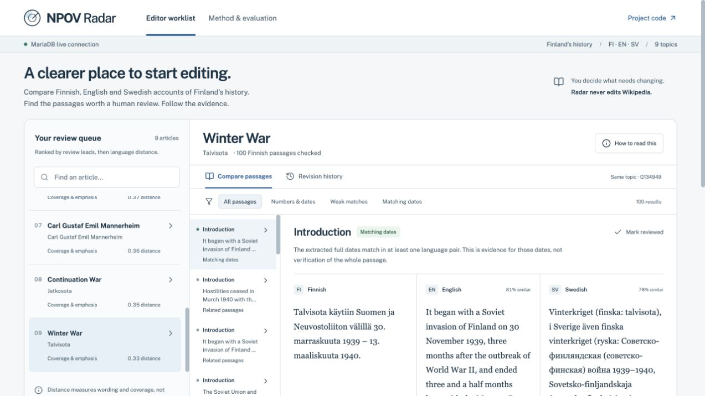

# NPOV Radar

An evidence desk for Wikipedia editors comparing Finland's history in Finnish, English and Swedish. Select an article, inspect related passages and their exact revisions, and prepare a review note. Radar never edits Wikipedia.

[Open the application](https://npov-radar.vercel.app) · [Evaluation ledger](eval/LEDGER.md) · [Two-minute demo](DEMO_SCRIPT.md)



## What works

- Nine topics, 27 live article versions and 2,308 sentence vectors. MariaDB `VECTOR(384)` and `VEC_DISTANCE_COSINE` retrieve English and Swedish passages for each Finnish passage, restricted to the same Wikidata topic.
- Deterministic full-date and unit checks produce cautious review leads. Different emphasis and weak retrieval matches are not called contradictions. The worklist uses a review-count/distance heuristic, not a validated neutrality score.
- 12,944 real Wikipedia revision rows in MariaDB `WITH SYSTEM VERSIONING`. `FOR SYSTEM_TIME ALL` lists edits and `AS OF` retrieves genuine historical content. Original edit times remain UTC; archive-to-live gaps remain gaps.
- Exact passage and revision links, local-device review marks, an editable-in-Wikipedia link and a draft note copied only at the user's request.
- A curated cited-source check supports the Finnish War start date using a short Yle excerpt. Other source checks explicitly abstain.
- A live planted-error lab retrieves a real passage, changes a copy, and exposes caught date edits and missed name swaps. Synthetic text is never stored as a Wikipedia revision.

## Evidence and limits

Fresh article held-out synthetic rule tests caught **18/20** constructed errors, with **0/22** negative controls flagged. The misses were country-name swaps. Similarity is fixed at 1 for these edited-copy tests; they isolate the rules and do not test the full retrieval pipeline. Labels come from mutation construction, not people.

The weak cross-language date-overlap retrieval proxy found **7/9** held-out targets with vector search and **8/9** with lexical search. This is not a benchmark win. The proxy has only 16 pairs overall and equal dates can describe different events. Nine archived-revision checks pass against the supplied metadata after a UTC correction.

No human gold labels, calibrated model judges, whole-article LLM baseline or real-world contradiction precision/recall are available. The model truncates at 128 tokens; we cap sentence length, but some truncation remains possible. Only the first 100 usable passages per language/article are considered. Source support is mostly unverified. See the ledger for raw results, failures and split history.

## Run the frontend

Node 20.19+ or 22.12+.

```sh
npm ci
npm run dev
npm run build
```

The committed `public/snapshot.json` is an actual export of native MariaDB query results. It keeps the evidence desk readable without a database. A status indicator distinguishes live API connectivity from saved results. `public/history-snapshot.json` keeps saved revision listings available; arbitrary time travel requires the live database.

## Run the real database pipeline

Use an authorized MariaDB server **11.7+**, with vector search and `system_versioning_insert_history` available. This build ran on isolated MariaDB **13.0.2** on macOS, via a local Unix socket. No SQL port is exposed. SQL schema creation and historical import need appropriate privileges. Use your own existing database credentials or local socket authentication; keep them in the environment, never in git.

```sh
python3.11 -m venv .venv
.venv/bin/pip install -r requirements.txt
mkdir -p work
# Official source of the supplied S article files. Application code is not copied.
git clone --depth 1 https://github.com/MariaDB/mariadb-vector-wikipedia-rag work/vector-starter
.venv/bin/python scripts/download-data.py
# Default socket: work/mariadb.sock, user: current OS user.
# Or set DB_HOST / DB_PORT / DB_USER / DB_PASSWORD for an existing reachable server.
.venv/bin/python scripts/ingest.py
.venv/bin/python scripts/fetch-source.py
.venv/bin/python scripts/update-findings.py
.venv/bin/python scripts/export-history.py
.venv/bin/python -m server.app
```

The first import fetches current extracts, interlanguage links and three latest revisions via Wikipedia APIs. It loads the selected Finnish histories from M, preserving each revision's time. The final archived row ends at the 1 October 2026 archive cutoff, never at a fabricated next-live-edit time. Two revisions in the same second with zero validity intervals are skipped rather than assigned invented timestamps.

`server/db.py` contains the actual parameterized vector and temporal SQL. The public API exposes only fixed read queries with bounded inputs, not arbitrary SQL or writes. `scripts/start-db.sh` is the build-machine restart command and expects its isolated local runtime under `work/runtime`; it is not a general installer.

## Reproduce evaluations

```sh
.venv/bin/python scripts/prepare-confirmation.py
.venv/bin/python scripts/evaluate.py
.venv/bin/python scripts/retrieval-eval.py
.venv/bin/python scripts/scale-probe.py
```

The scripts keep per-case traces. `eval/annotation-queue.csv` contains 60 real retrieved pairs with deliberately empty human-label fields. An expert still needs to annotate them. The sheet covers all nine topics with exact revision links; see [annotation guidance](eval/ANNOTATING.md). The S/M/L files differ in content and purpose, not just size. Only a bounded L probe was loaded, 1,000 of 568,416 rows. Full-scale quality, memory use and concurrency are unmeasured.

## Deployment

Vercel serves the React/Vite frontend and the fixed read-only API proxy in `api/radar.js`. `RADAR_API_ORIGIN` points to the read-only backend, never to MariaDB's SQL port. The current backend is on the build Mac behind a temporary Cloudflare tunnel, so live queries require the Mac online. This is a hackathon hosting dependency, not a durable managed database deployment. Saved evidence remains accessible if it disconnects. No account credentials are sent to the frontend.

All new project code was written during Junction 2026. The code is MIT. Wikipedia text and derived data remain CC BY-SA 4.0, and third-party excerpts retain their copyright. See [data attribution](DATA_LICENSE.md).
