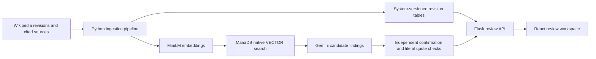

# Parallax

Review Wikipedia claims against their cited sources and other language editions. Keep the evidence beside the sentence.

[Open Parallax](https://parallax-gamma-red.vercel.app) · [Evaluation](eval/parallax/EVALUATION.md) · [Data licences](DATA_LICENSE.md)

Built by Shreyansh, team The CS Guy, for Junction 2026's MariaDB challenge, Wikipedia Through Time.

## What you can do

Choose a topic, compare Finnish, Swedish and English coverage, and inspect a finding with its article passage, source passage and revision history. A reviewer can see why the system raised a concern before deciding whether it deserves attention. Parallax never edits Wikipedia.

The useful distinction is between a supported finding, an unresolved concern and a source the system could not check. An unreadable book does not become evidence of a contradiction. Cross-language differences are leads for review, not proof that an edition is wrong.

## How it works today



MariaDB stores the evidence and its history. Native VECTOR cosine retrieval finds related passages; system-versioned tables preserve earlier revision states. MiniLM produces retrieval embeddings. Gemini proposes candidate issues and a separate confirmation step checks them. Literal quote validation prevents the interface from presenting model-invented quotations as source text.

The browser shows the resulting evidence. A model output cannot silently modify an article or substitute for a human editorial decision.

## Sponsors and model roles

| Service | Current use | What to inspect |
| --- | --- | --- |
| MariaDB | Implemented. Native vector retrieval and system-versioned article history form the core review path. | `pipeline/`, `service/` and `deploy/` |
| Gemini API | Implemented. Candidate generation and independent confirmation over retrieved evidence. | The finding pipeline and linked evaluation |
| Codex | Used during development, debugging and verification. It is a development tool, not an autonomous Wikipedia editor. | Repository implementation and test history |
| CRACI | **Planned, not implemented.** Run the existing build and Python tests on CRACI CI. | Acceptance plan below |

Technology-prize registration records intent. It does not establish completed eligibility for a planned integration.

## Run locally

Use Node.js for the Vite frontend and a Python virtual environment for the API. Supply provider credentials through the process environment or your secret manager. Never commit credentials.

```bash
npm ci
npm run dev
```

The Vite development proxy sends `/api/parallax` to `127.0.0.1:18808` by default. `PARALLAX_DEV_API` selects another API origin. The UI needs an initialized API and MariaDB dataset; the frontend command alone does not create either.

After configuring the dataset and credentials, start the API in a second terminal:

```bash
python3 -m venv .venv
.venv/bin/python -m pip install -r requirements.txt
.venv/bin/python -m service.app
```

The Python dependencies are in `requirements.txt` and `deploy/requirements-api.txt`. The API entry point is `service/app.py`; deployment material lives in `deploy/`. Configure MariaDB and initialize the ingestion pipeline before starting the API. This repository does not offer a verified one-command database bootstrap.

## Verify a change

```bash
npm run build
.venv/bin/python -m unittest discover -s tests
```

For a real review check, open the live workspace, load an article, inspect the cited passage and compare its history. Wait for the article and source text to load before taking screenshots. Older video and review-race scripts contain superseded shared-review interactions; they are not current acceptance proof.

## Evidence and limits

The prepared collection covers 22 topics, measured in the project dataset. Controlled planted-change runs detected 32/40, 34/40 and 40/40 changes, each with 0/40 false flags on its paired controls. These are separate measured runs with changing prompts and edit conditions, not three independent estimates of population accuracy.

A blind AI-labelled check found 44/60 before later filtering. It is not expert-labelled precision for the current filtered product. Read the [evaluation protocol and results](eval/parallax/EVALUATION.md) before reusing any score.

Retrieval can miss evidence. Unavailable citations remain unchecked. Translation and editorial context require human judgement. A successful seeded test does not establish accuracy across Wikipedia.

## Next integration, after implementation approval

CRACI will run the repository's real checks in a GitHub Actions job with `runs-on: craci`. Completion requires a successful CRACI-backed run, linked logs and a deliberate failing-test check that blocks the job. No CRACI workflow or successful sponsor run is claimed today.

The current application architecture above describes implemented components. This CI addition is planned and does not change the review algorithm.

## Repository guide

| Path | Purpose |
| --- | --- |
| `pipeline/` | Ingestion, retrieval and finding generation |
| `service/app.py` | Review API |
| `deploy/` | API dependencies and deployment configuration |
| `tests/` | Python regression checks |
| `eval/parallax/` | Recorded evaluation and its limitations |

Wikipedia text and external sources retain their original licences. See [DATA_LICENSE.md](DATA_LICENSE.md) for attribution and reuse conditions.
